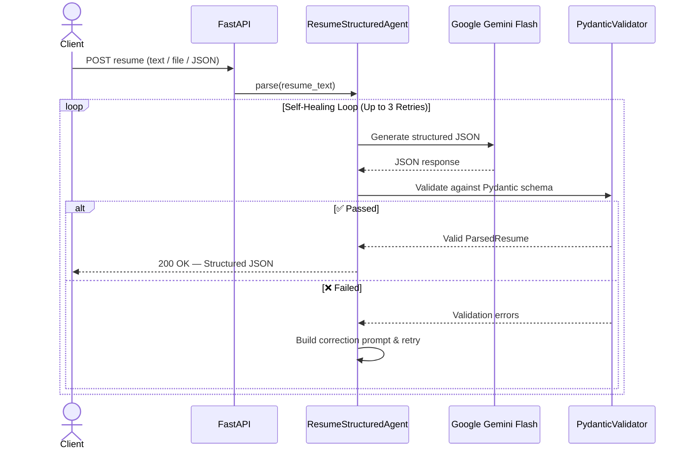

# AI Resume Parser — Structured Output Agent

[](https://fastapi.tiangolo.com)
[](https://docs.pydantic.dev/)
[](https://aistudio.google.com/)
[](https://www.python.org/)
[](https://opensource.org/licenses/MIT)

An AI microservice that converts messy, unstructured resumes into validated, structured JSON using Google Gemini. It includes a **Self-Healing Loop** — if the AI output fails validation, the errors are automatically fed back to fix it (up to 3 retries).

---

## How It Works



---

## Key Features

- **Strict Schema Validation** — Pydantic v2 models with `EmailStr`, type constraints, and required fields
- **Google Gemini Flash** — Low-temperature JSON mode for deterministic extractions
- **Self-Healing Retries** — Validation errors are fed back to the model for automatic correction
- **Multiple Input Modes** — JSON body, plain text paste, or file upload (PDF, DOCX, TXT)
- **Failure Telemetry** — Rotating logs via Loguru + API endpoint for inspection
- **One-Click Deploy** — Pre-configured `render.yaml` for Render.com

---

## Project Structure

```
Document-Parse/
├── app/
│   ├── config.py              # Environment settings
│   ├── main.py                # FastAPI endpoints
│   ├── agent/
│   │   ├── gemini_client.py   # Gemini API wrapper
│   │   ├── validator.py       # Pydantic validation & error extraction
│   │   └── retry_agent.py     # Self-healing retry loop
│   ├── schemas/
│   │   ├── request.py         # Request & response models
│   │   └── resume.py          # Resume data models
│   ├── static/
│   │   └── index.html         # Web UI
│   └── utils/
│       ├── file_extractor.py  # PDF/DOCX/TXT text extraction
│       └── logger.py          # Loguru telemetry
├── sample_data/               # Sample resumes for testing
├── tests/                     # pytest test suite
├── .env.example               # Environment template
├── render.yaml                # Render deployment config
└── requirements.txt
```

---

## Getting Started

### Prerequisites
- Python 3.10+
- A free [Google Gemini API Key](https://aistudio.google.com/)

### Setup

```bash
# Clone & enter the project
git clone https://github.com/MawraMusawar/Document-Parse.git
cd Document-Parse

# Create virtual environment
python -m venv venv
.\venv\Scripts\activate        # Windows
# source venv/bin/activate     # macOS / Linux

# Install dependencies
pip install -r requirements.txt

# Configure environment
copy .env.example .env         # Windows
# cp .env.example .env         # macOS / Linux
```

Open `.env` and add your API key:
```ini
GEMINI_API_KEY=your_key_here
```

### Run

```bash
uvicorn app.main:app --host 0.0.0.0 --port 8000 --reload
```

Open [http://localhost:8000/docs](http://localhost:8000/docs) for interactive API docs.

---

## API Endpoints

| Method | Endpoint | Description |
|--------|----------|-------------|
| `GET` | `/` | Web UI |
| `GET` | `/health` | Health check |
| `POST` | `/api/v1/parse-resume` | Parse resume (JSON body) |
| `POST` | `/api/v1/parse-resume-text` | Parse resume (plain text) |
| `POST` | `/api/v1/parse-resume-file` | Parse resume (file upload: PDF, DOCX, TXT) |
| `GET` | `/api/v1/telemetry/failures` | View validation failure logs |

### Example Request

```bash
curl -X POST http://localhost:8000/api/v1/parse-resume \
  -H "Content-Type: application/json" \
  -d '{"resume_text": "John Doe\nEmail: john@example.com\nSenior Python Engineer with 5 years experience"}'
```

### Example Response

```json
{
  "success": true,
  "attempts_made": 1,
  "processing_time_ms": 1420.5,
  "data": {
    "summary": "Experienced Python Engineer specializing in cloud systems.",
    "personal_info": { "full_name": "John Doe", "email": "john@example.com" },
    "total_years_experience": 5.0,
    "skills": { "technical_skills": ["Python", "FastAPI"], "soft_skills": [], "tools_and_platforms": [], "languages": [] },
    "work_experience": [],
    "education": [],
    "certifications": []
  }
}
```

---

## Deploy on Render (Free)

1. Push your code to GitHub
2. Go to [Render.com](https://render.com) → **New +** → **Web Service**
3. Connect your repo and configure:
   - **Build Command:** `pip install -r requirements.txt`
   - **Start Command:** `uvicorn app.main:app --host 0.0.0.0 --port $PORT`
   - **Instance Type:** Free
4. Add environment variable: `GEMINI_API_KEY` = `your_key`
5. Click **Deploy** — live in ~2 minutes at `https://your-app.onrender.com/docs`

---

## Running Tests

```bash
pytest -v
```

---

## License

MIT License
