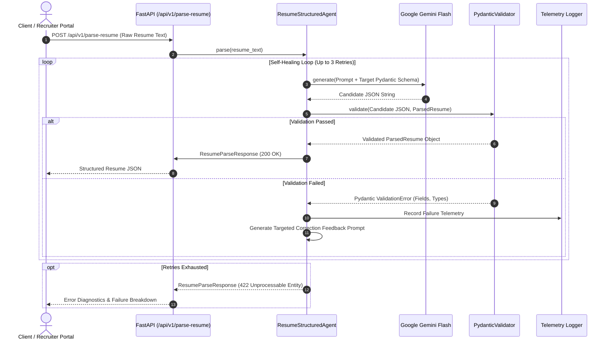

# AI Resume Parser — Structured Output Agent

[](https://fastapi.tiangolo.com)
[](https://docs.pydantic.dev/)
[](https://aistudio.google.com/)
[](https://www.python.org/)
[](https://opensource.org/licenses/MIT)

> **Core Philosophy:** *"Make LLMs reliable, not random"*

A production-grade AI microservice designed to transform messy, unstructured candidate resumes into strictly typed, schema-validated JSON. It features a built-in **Self-Healing Error Correction Loop** that intercepts Pydantic validation failures and prompts Gemini to fix exact discrepancies in real-time, backed by telemetry logging and an interactive FastAPI Swagger documentation.

---

## 📑 Table of Contents
- [Architecture & Workflow](#-architecture--workflow)
- [Key Features](#-key-features)
- [Project Structure](#-project-structure)
- [Local Installation & Setup](#-local-installation--setup)
- [Running the Application](#-running-the-application)
- [API Documentation](#-api-documentation)
- [How to Deploy Live on Render (100% Free)](#-how-to-deploy-live-on-render-100-free)
- [Running Tests](#-running-tests)
- [Telemetry & Observability](#-telemetry--observability)

---

## 🏛 Architecture & Workflow



---

## ✨ Key Features

1. **Strict Pydantic v2 Models:**
   - Complete type safety over contact details (`EmailStr`), work history, educational milestones, and categorized skillsets.
   - Enforces value constraints (e.g., non-negative years of experience, valid email patterns).

2. **Google Gemini Flash Integration:**
   - High throughput and low latency inference using the official `google-genai` SDK.
   - Native JSON schema enforcement with low temperature for deterministic extractions.

3. **Self-Healing Reflection Loop:**
   - Zero-crash architecture: When output fails schema constraints, the validator constructs a precise error breakdown and re-queries the model with targeted instructions.

4. **Failure Telemetry & Logging:**
   - Structured JSON and rotating logs via `loguru` (`logs/validation_failures.log`).
   - Dedicated API telemetry inspection endpoint at `/api/v1/telemetry/failures`.

5. **Cloud-Ready for Render:**
   - Pre-configured `render.yaml` blueprint for one-click deployment.
   - Native support for dynamic port allocation (`PORT` env var) and health checks (`/health`).

---

## 📂 Project Structure

```text
Document-Parse/
├── app/
│   ├── __init__.py
│   ├── config.py              # Environment configuration & settings
│   ├── main.py                # FastAPI endpoints, CORS, and lifespan
│   ├── agent/
│   │   ├── __init__.py
│   │   ├── gemini_client.py   # Google Gemini API connector
│   │   ├── validator.py       # Pydantic validation & error extractor
│   │   └── retry_agent.py     # Self-healing feedback loop controller
│   ├── schemas/
│   │   ├── __init__.py
│   │   ├── request.py         # Request & response payloads
│   │   └── resume.py          # ParsedResume domain models
│   └── utils/
│       ├── __init__.py
│       └── logger.py          # Loguru telemetry recorder
├── sample_data/
│   ├── sample_resume_clean.txt
│   └── sample_resume_messy.txt
├── tests/
│   ├── __init__.py
│   ├── test_api.py            # API endpoint integration tests
│   └── test_schemas.py        # Schema validation unit tests
├── .env.example               # Environment variables template
├── .gitignore
├── render.yaml                # Infrastructure-as-code for Render.com
├── requirements.txt           # Production dependencies
└── README.md                  # Project documentation
```

---

## 💻 Local Installation & Setup

### Prerequisites
- Python 3.10 or higher
- A free Google Gemini API Key from [Google AI Studio](https://aistudio.google.com/)

### 1. Clone the Repository
```bash
git clone https://github.com/MawraMusawar/Document-Parse.git
cd Document-Parse
```

### 2. Create and Activate a Virtual Environment
```bash
# Windows
python -m venv venv
.\venv\Scripts\activate

# macOS / Linux
python3 -m venv venv
source venv/bin/activate
```

### 3. Install Dependencies
```bash
pip install -r requirements.txt
```

### 4. Configure Environment Variables
Copy the example environment template:
```bash
# Windows PowerShell
Copy-Item .env.example .env

# Linux / macOS
cp .env.example .env
```
Open `.env` and insert your Gemini API Key:
```ini
GEMINI_API_KEY=AIzaSy...your_actual_key_here
GEMINI_MODEL_NAME=gemini-2.5-flash
MAX_RETRY_ATTEMPTS=3
```

---

## 🚀 Running the Application

Start the local development server:
```bash
uvicorn app.main:app --host 0.0.0.0 --port 8000 --reload
```

- **Interactive Swagger Documentation:** [http://localhost:8000/docs](http://localhost:8000/docs)
- **Alternative ReDoc:** [http://localhost:8000/redoc](http://localhost:8000/redoc)
- **Health Check Endpoint:** [http://localhost:8000/health](http://localhost:8000/health)

---

## 📡 API Documentation

### 1. Parse Resume Endpoint
- **URL:** `/api/v1/parse-resume`
- **Method:** `POST`
- **Request Body:**
```json
{
  "resume_text": "John Doe\nEmail: john@example.com\nSenior Python Engineer with 5 years experience..."
}
```

- **Successful Response (200 OK):**
```json
{
  "success": true,
  "attempts_made": 1,
  "processing_time_ms": 1420.5,
  "data": {
    "summary": "Experienced Python Engineer specializing in cloud systems.",
    "personal_info": {
      "full_name": "John Doe",
      "email": "john@example.com",
      "phone": null,
      "location": null,
      "linkedin_url": null,
      "github_url": null,
      "portfolio_url": null
    },
    "total_years_experience": 5.0,
    "skills": {
      "technical_skills": ["Python", "FastAPI", "PostgreSQL"],
      "soft_skills": [],
      "tools_and_platforms": ["Docker", "Git"],
      "languages": ["English"]
    },
    "work_experience": [],
    "education": [],
    "certifications": []
  },
  "validation_failures": null
}
```

---

## ☁️ How to Deploy Live on Render (100% Free)

You can deploy this API on Render completely free in a few steps:

### Step 1: Push Changes to GitHub
Make sure all your project files are pushed to GitHub:
```bash
git add .
git commit -m "feat: complete structured resume parser agent"
git push origin main
```

### Step 2: Create a Web Service on Render
1. Visit [Render.com](https://render.com) and sign in with your GitHub account.
2. In the Render Dashboard, click **New +** and select **Web Service**.
3. Select your repository: **`MawraMusawar/Document-Parse`**.

### Step 3: Configure Service Details
Fill in the deployment settings:
- **Name:** `structured-resume-parser` (or any preferred name)
- **Region:** Any (e.g., Oregon or Frankfurt)
- **Branch:** `main`
- **Runtime:** `Python 3`
- **Build Command:**
  ```bash
  pip install -r requirements.txt
  ```
- **Start Command:**
  ```bash
  uvicorn app.main:app --host 0.0.0.0 --port $PORT
  ```
- **Instance Type:** `Free`

### Step 4: Add Environment Variable
Scroll down to the **Environment Variables** section and add:
- **Key:** `GEMINI_API_KEY`
- **Value:** `your_gemini_api_key_from_google_ai_studio`

*(Optional)* You can also configure:
- `GEMINI_MODEL_NAME` = `gemini-2.5-flash`
- `MAX_RETRY_ATTEMPTS` = `3`

### Step 5: Deploy & Test Live
1. Click **Deploy Web Service**.
2. Within 2-3 minutes, Render will build and launch your application.
3. Access your live API interactive documentation at:
   👉 **`https://your-service-name.onrender.com/docs`**

---

## 🧪 Running Tests

Execute the comprehensive unit and integration test suite:
```bash
pytest -v
```

Output:
```text
tests/test_api.py::test_root_endpoint PASSED
tests/test_api.py::test_health_check_endpoint PASSED
tests/test_api.py::test_telemetry_failures_endpoint PASSED
tests/test_api.py::test_parse_resume_missing_api_key PASSED
tests/test_schemas.py::test_personal_info_valid PASSED
tests/test_schemas.py::test_personal_info_invalid_email PASSED
tests/test_schemas.py::test_negative_experience_rejected PASSED
tests/test_validator_cleans_markdown_fences PASSED
tests/test_validator_catches_syntax_errors PASSED
```

---

## 📊 Telemetry & Observability

- Real-time failures are logged into `logs/validation_failures.log`.
- To inspect failure statistics and recent validation traps directly via API, query:
  `GET /api/v1/telemetry/failures?limit=20`

---

## 📄 License
This project is licensed under the MIT License.
